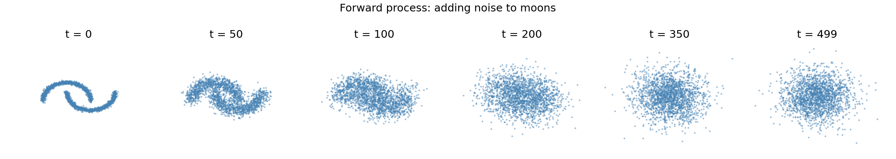
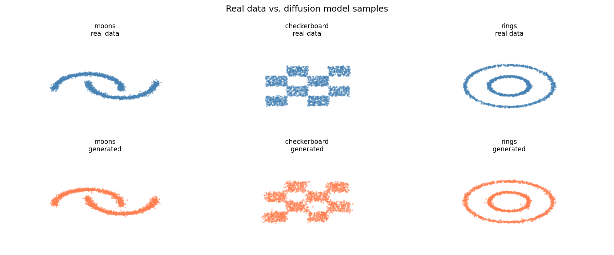
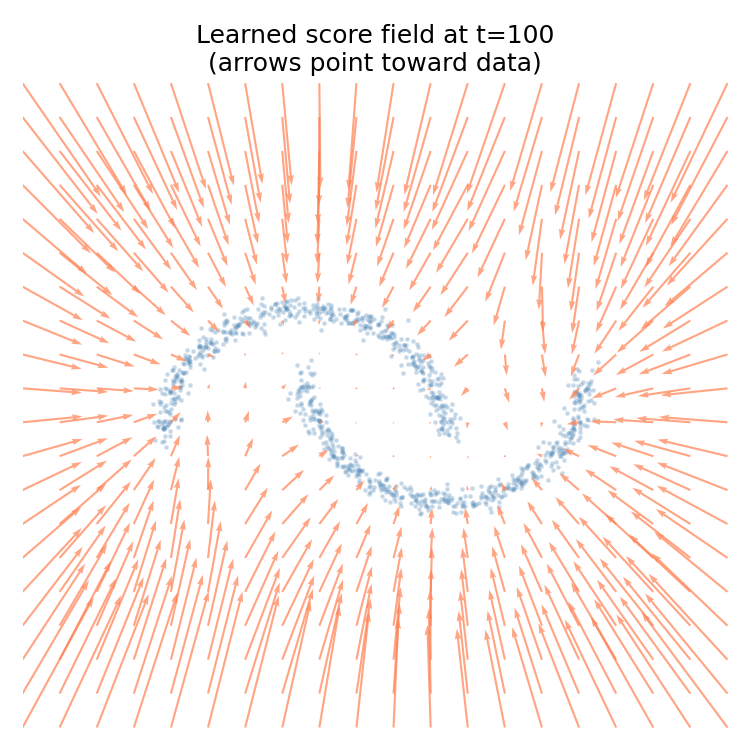
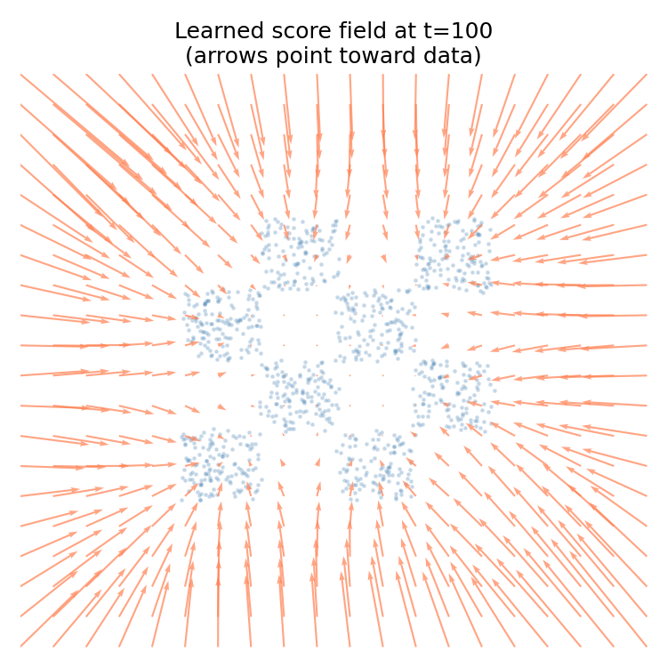

# Diffusion Models from Scratch

A from-scratch implementation of DDPM (Denoising Diffusion Probabilistic Models) trained on 2D toy distributions. No diffusers library, no pretrained weights — just the math, implemented cleanly.

The 2D setting is deliberately chosen: you can see the entire distribution, watch the denoising process, and visualise the learned score function as an arrow field. Everything that happens inside image diffusion models also happens here, just in a space you can look at directly.

---

## How it works

**Forward process** — take a data point and gradually corrupt it with Gaussian noise over T steps until it's indistinguishable from pure noise:

```
x_t = sqrt(ᾱ_t) · x₀  +  sqrt(1 - ᾱ_t) · ε,   ε ~ N(0, I)
```

where `ᾱ_t = ∏ αₛ` is the cumulative product of the noise schedule.



**Backward process** — train a small neural network to predict the noise `ε` that was added at each step. At inference, run it in reverse from pure Gaussian noise, iteratively denoising 500 times until you get a sample from the learned distribution.

**Score field** — the noise prediction `ε_θ(x_t, t)` is proportional to the negative score `∇ log p(x_t)`: the gradient of the log-probability of the noisy data. Visualised as an arrow field, it shows the direction each point should move to become more likely under the data distribution.

---

## Results

### Generated samples vs. real data



The model recovers all three distributions — including the checkerboard, which requires learning a disconnected multi-modal distribution with sharp boundaries.

### Learned score fields at t=100

The arrows point toward where the data is. At moderate noise levels you can see the model has learned the geometry of each distribution:

| Moons | Checkerboard |
|-------|--------------|
|  |  |

---

## Running it

```bash
pip install -r requirements.txt

python train.py moons
python train.py checkerboard
python train.py rings

python analysis.py
```

Training each dataset takes about 10 minutes on CPU (~5 on M-series Mac). Checkpoints are saved to `checkpoints_{dataset}/`.

---

## Files

| File | Description |
|------|-------------|
| `model.py` | Time-conditioned MLP with sinusoidal embeddings |
| `diffusion.py` | Linear noise schedule, forward process, reverse sampling |
| `data.py` | 2D toy datasets: moons, checkerboard, rings |
| `train.py` | Training loop — simple MSE on predicted vs. actual noise |
| `analysis.py` | Forward process viz, reverse trajectories, score fields, sample comparison |

---

## References

- Ho et al. 2020 — [Denoising Diffusion Probabilistic Models](https://arxiv.org/abs/2006.11239)
- Song & Ermon 2020 — [Score-Based Generative Modeling through SDEs](https://arxiv.org/abs/2011.13456)
